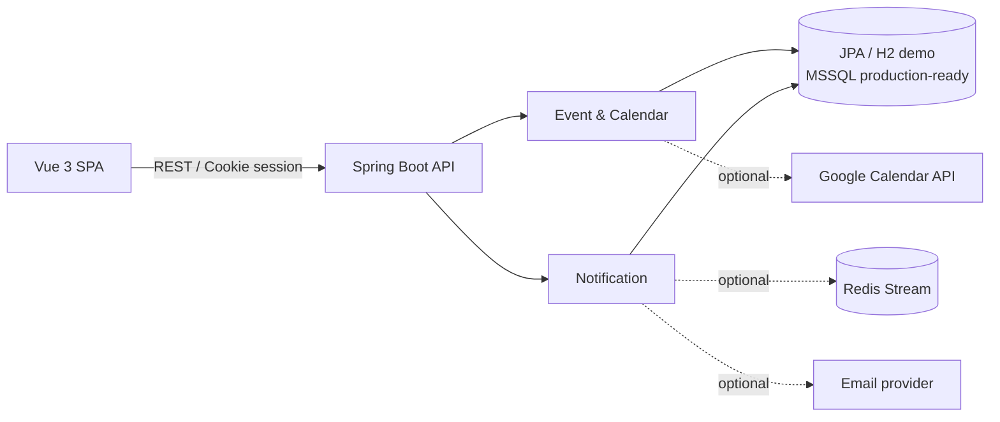

# EventFlow

活動、行事曆與通知系統的全端作品集。前端使用 Vue 3，後端使用 Java 17 / Spring Boot，涵蓋活動 CRUD、月曆與地圖瀏覽、追蹤提醒、通知偏好、寄送工作、Google Calendar 同步與管理儀表板。

> 本專案是從團隊作品 **SneakerMarket／酷客 Kicks** 中，抽出曹志宗獨立負責的 event、calendar、notification 前後端模組，再加入可獨立啟動的展示用轉接層。商城、競標、訂單及原團隊會員驗證模組未包含在此版本。詳細界線請見 [OWNERSHIP.md](OWNERSHIP.md)。

## 可展示的功能

- 活動後台：建立、搜尋、分頁、編輯、刪除、圖片與地點座標。
- 公開行事曆：列表、月曆、地圖三種檢視及活動詳情。
- 會員追蹤：追蹤／取消追蹤活動、自訂提前提醒時間。
- 通知中心：通知建立、發送、已讀／全部已讀、寄送紀錄。
- 訂閱與偏好：依品牌、分類、站內通知及 Email 條件控制。
- 背景工作：Redis Stream 生產者／消費者與失敗重試設計。
- 外部整合：Google OAuth 連線及 Calendar event 同步。
- 管理儀表板：活動與通知統計、趨勢圖表。

## 架構



本機預設使用 H2 記憶體資料庫、虛構展示資料及 Demo Session。Redis、Email、Google Calendar 預設關閉，因此不需要任何密鑰即可瀏覽主要流程。

## 技術棧

| Layer | Technology |
| --- | --- |
| Backend | Java 17, Spring Boot 4, Spring MVC, Spring Data JPA, Bean Validation |
| Data / async | H2, Microsoft SQL Server driver, Redis Stream |
| Integration | Google OAuth 2.0, Google Calendar API, JavaMail |
| Frontend | Vue 3, Vue Router, Axios, Bootstrap, Leaflet, Chart.js |
| Quality | JUnit 5, Mockito, Maven Surefire, Vite production build |

## 快速啟動

需求：JDK 17、Node.js 20.19+（或 22.12+）。專案已包含 Maven Wrapper。

### 1. 啟動後端

```powershell
cd backend
$env:APP_DEMO_MODE = "true"
.\mvnw.cmd spring-boot:run
```

後端預設位址：`http://localhost:8080`

### 2. 啟動前端

另開一個終端機：

```powershell
cd frontend
Copy-Item .env.example .env.local
npm install
npm run dev
```

瀏覽：`http://localhost:5173`

Demo mode 會建立虛構活動與通知，並以本機展示會員進入需要 Session 的功能。這是作品展示便利功能，不應直接用於正式環境；正式部署請將 `APP_DEMO_MODE=false` 並接回實際驗證模組。

## 驗證

```powershell
# Backend: 43 tests
cd backend
.\mvnw.cmd test

# Frontend production build
cd ..\frontend
npm run build

# Dependency vulnerability report
npm audit --omit=dev
```

目前模組規模：101 個主要 Java source files、29 個 API mappings、9 個測試檔／43 個 JUnit tests、37 個 Vue components/views。

## 設定與密鑰

- 前端範例：[frontend/.env.example](frontend/.env.example)
- 後端環境變數範例：[backend/.env.example](backend/.env.example)
- 所有 Google、資料庫及郵件密鑰均由環境變數提供；repository 不應提交真實密鑰。

## Repository 結構

```text
EventFlow-Portfolio/
├─ backend/              Spring Boot API、domain、service、tests
├─ frontend/             Vue 3 UI、routes、components、services
├─ OWNERSHIP.md          團隊專案與個人貢獻界線
└─ README.md
```

求職使用的履歷條列與面試說法整理在 [docs/履歷專案描述.md](docs/履歷專案描述.md)，完整測試與人工檢查結果則記錄於 [docs/驗收結果.md](docs/驗收結果.md)。

## 公開前提醒

這份抽出版沒有包含原私人 repository 的 Git history。公開前仍應先確認團隊共識與課程規範，並再次執行敏感資料掃描。
